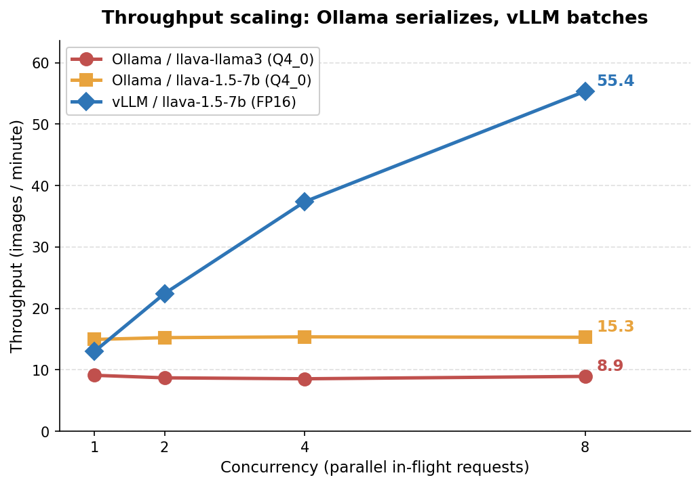
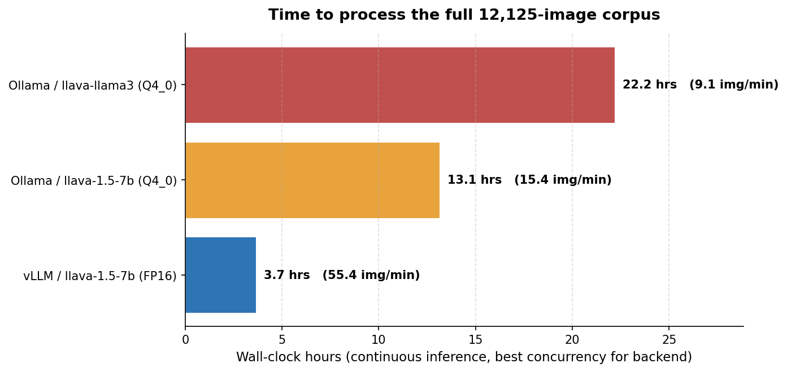
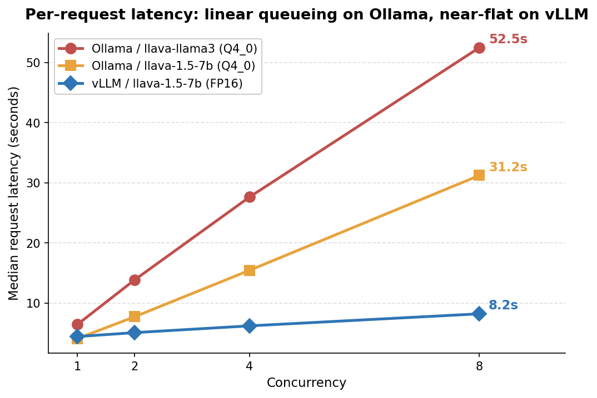
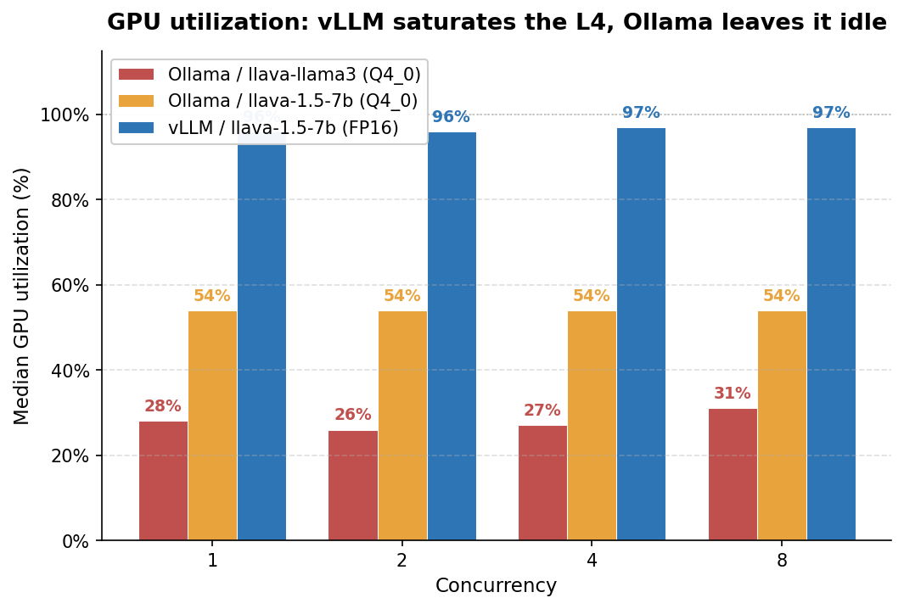

# LLaVA Vision-LLM Throughput Evaluation on NVIDIA L4

> **A controlled comparison of inference-serving backends for production vision-language workloads on a single 23 GB GPU.**

This project is a performance-engineering case study: how to identify when your throughput ceiling is in hardware versus in software, and what to do about it. The work measures three configurations of the same workload — image classification with a 7B-parameter vision-language model (LLaVA) — across two serving backends (Ollama and vLLM), at four concurrency levels each, with consistent instrumentation throughout.

The headline finding: **at concurrency 8, vLLM with continuous batching delivers 6.22× the throughput of the production Ollama configuration on the same NVIDIA L4 GPU**, with GPU utilization climbing from ~30% to 97%.

---

## The headline



**Two flat lines and one rising line.** The two Ollama configurations remain at their single-stream throughput regardless of how many concurrent requests are dispatched — the classic signature of internal request serialization. The vLLM configuration scales 4.26× from C=1 to C=8 on identical hardware, exploiting continuous batching to fuse multiple in-flight requests into a single forward pass.

The implication for the production workload: a 12,125-image corpus that takes ~22 hours on the existing Ollama stack takes ~3.7 hours on vLLM. Same single L4 GPU. No new hardware required.



---

## The full comparison

Same 30-image sample, same prompt (a locked combined-prompt design refined through a 1,200-call experiment), same NVIDIA L4 hardware, same C=1/2/4/8 concurrency sweep in every case:

| Configuration | Backend | Model | Quantization | C=8 Throughput | GPU util |
|---|---|---|---|---|---|
| Production baseline | Ollama 0.3.14 | llava-llama3 | Q4_0 | 8.9 img/min | 31% |
| Same-base-model on Ollama | Ollama 0.3.14 | llava-1.5-7b | Q4_0 | 15.3 img/min | 54% |
| Same-base-model on vLLM | vLLM 0.6.6 | llava-1.5-7b | FP16 | **55.4 img/min** | **97%** |

The third row is the same-model bridge: with `llava-1.5-7b` on both backends, the 3.6× speedup isolates the contribution of the serving architecture alone. The 6.2× headline number against the production baseline combines that architectural improvement with a smaller per-call cost from the lighter model.

---

## The "why" — diagnostic evidence

### The Ollama signature: serialization



Per-request latency scales near-linearly with concurrency on both Ollama configurations. At C=8 on llava-llama3, the median request takes **8.18× longer** than at C=1. That is exactly the pattern produced if eight concurrent requests are queued and processed one at a time behind a single-server bottleneck — not the pattern produced by a busy GPU.

By contrast, vLLM's per-request latency rises only 1.86× from C=1 to C=8, which is the signature of true parallel execution — the GPU is processing the requests together, not sequentially.

### The L4 is idle on Ollama



Median GPU utilization tells the same story from a different angle. Ollama exercises 26–54% of the L4 regardless of concurrency. vLLM saturates the GPU at 96–97% at every level. The hardware was capable of handling more work the entire time — the serving stack just couldn't dispatch it.

### Both confirm: the bottleneck is the serving stack

| Property | What we observed on Ollama | What it indicates |
|---|---|---|
| Throughput | Flat across C=1, 2, 4, 8 | No parallelism happening |
| Latency | Grows linearly with C | Queueing, not GPU saturation |
| VRAM | Constant 5191 / 6139 MB | No per-request KV cache being allocated |
| GPU util | Constant ~30% / 54% | The GPU is not the limit |
| Power draw | Constant ~50 / 60 W (cap 72 W) | The GPU is not at thermal/power ceiling |

The same signature appeared on both `llava-llama3` and `llava-1.5-7b` — confirming this is a property of the Ollama daemon's request scheduling at this version (0.3.14), not specific to any model.

---

## Methodology overview

### Hardware

Single NVIDIA L4 GPU on a Linux host. 23 GB VRAM (22.04 GiB usable), 72 W power cap, CUDA 12.4, driver 590.48.01.

### Workload

Vision-language image classification: each call submits one image + one prompt to the model and parses a structured JSON response with six required fields (title, description, offensiveness boolean, category, justification, confidence). Production target is a 12,125-image archival corpus.

### Three experiments

1. **Prompt-shape experiment.** 50 images × 3 prompt variants × 3 repeats = 1,200 calls. Compared a three-call split design against a combined single-call design. The combined design proved 1.61× faster while preserving structural validity. This is the prompt locked in for all downstream concurrency measurements.

2. **Concurrency experiment on Ollama.** 30 images × 4 concurrency levels = 120 calls. Run twice — once on the production model (`llava-llama3:latest`) and once on the same base model as vLLM (`llava:7b`, which is `llava-v1.5-7b` in Q4_0). Both runs showed flat throughput across concurrency levels.

3. **Concurrency experiment on vLLM.** Same 30 images, same 4 concurrency levels, same prompt, same hardware — pointed at vLLM 0.6.6 serving `llava-hf/llava-1.5-7b-hf` at FP16. Throughput scaled 4.26×.

### Instrumentation

A 2 Hz resource monitor (`utils/perf_monitor.py`) ran throughout every experiment. For every inference call: HTTP wall time, prompt-eval time, decode time, token counts. For every 500 ms: GPU utilization, VRAM, power, GPU temperature, CPU per-thread, system memory. All written to parquet files keyed by timestamp and experimental stage. The data set is in `data/` and is sufficient to regenerate every chart from scratch.

---

## What's in this repo

```
.
├── README.md                                # this file
├── LICENSE                                  # MIT
├── requirements.txt                         # pinned Python deps
│
├── docs/
│   ├── performance_engineering_report.pdf   # 17-page formal writeup
│   ├── performance_engineering_report.md    # markdown source
│   └── charts/                              # the four headline visualizations
│
├── benchmarks/
│   ├── benchmark_prompts.py                 # prompt-shape experiment
│   ├── benchmark_concurrency.py             # Ollama concurrency sweep
│   ├── benchmark_concurrency_vllm.py        # vLLM concurrency sweep
│   ├── build_report_charts.py               # regenerate the 4 charts from parquet
│   ├── analyze_prompt_outputs.py            # post-hoc parse-rate analyzer
│   └── test_prompt_iteration.py             # cheap smoke test for prompt variants
│
├── pipeline/
│   ├── image_classification_pipeline.py     # the production pipeline (anonymized)
│   ├── run_image_pipeline.py                # CLI wrapper
│   └── build_scoring_html.py                # post-hoc HTML viewer for human scoring
│
├── utils/
│   ├── perf_monitor.py                      # 2 Hz GPU/CPU/VRAM instrumentation
│   ├── log_reader.py                        # parquet log inspector
│   └── pipeline_logger.py                   # structured logger for the pipeline
│
└── data/
    ├── README.md
    ├── prompt_experiment/                   # 1,200-call prompt comparison
    ├── concurrency_ollama_llavallama3/      # 120-call Ollama llava-llama3 sweep
    ├── concurrency_ollama_llava7b/          # 120-call Ollama llava:7b sweep
    └── concurrency_vllm/                    # 120-call vLLM llava-1.5-7b sweep
```

---

## Reproducing the analysis

Anyone with the parquet files in `data/` can regenerate the four headline charts from raw measurements:

```bash
# 1. Set up
python3 -m venv venv && source venv/bin/activate
pip install -r requirements.txt

# 2. Regenerate the charts
python3 benchmarks/build_report_charts.py --verbose
# Charts land in output/report_charts/
```

The `--verbose` flag also prints the per-run summary tables and writes a `combined_data.csv` you can open in any spreadsheet.

## Reproducing the original benchmarks

If you have a comparable NVIDIA L4 (or other 22+ GB GPU) and want to reproduce the underlying measurements:

```bash
# Prerequisites
# - Ollama installed (0.3.14 or compatible)
# - vLLM in a separate Python env (0.6.6 or compatible)
# - llava-hf/llava-1.5-7b-hf model staged locally
# - Some sample images in ./images/

# Ollama benchmarks
ollama pull llava-llama3
ollama pull llava:7b
python3 benchmarks/benchmark_concurrency.py --model llava-llama3
python3 benchmarks/benchmark_concurrency.py --model llava:7b

# vLLM benchmark — start the server first
vllm serve ./models/llava-1.5-7b-hf \
    --dtype float16 \
    --gpu-memory-utilization 0.85 \
    --max-model-len 2048 \
    --enforce-eager \
    --chat-template ./models/llava-1.5-7b-hf/chat_template.jinja

# Then in another terminal:
python3 benchmarks/benchmark_concurrency_vllm.py \
    --ollama-baseline output/benchmark_concurrency/run_*/concurrency_report.md
```

Each script writes to `output/<experiment>/run_<timestamp>/` with parquet timings, JSONL outputs, resource samples, and a human-readable markdown report.

---

## Key findings, summarized

**On Ollama 0.3.14 as a production serving stack for vision-LLM workloads:** functional but throughput-limited. The daemon serializes requests internally for this workload regardless of `OLLAMA_NUM_PARALLEL` settings, leaving most of the GPU's compute idle. Appropriate for low-volume or development workloads; inappropriate for high-throughput production.

**On vLLM as a production alternative:** delivers what it advertises. Continuous batching produced 4.26× throughput scaling from C=1 to C=8 with only 1.86× per-request latency growth — clear evidence that requests are being processed in parallel within shared forward passes, not queued. GPU saturation reached 97% across all concurrency levels.

**On prompt design for structured-output vision-LLM workloads:** combining multiple per-image queries into a single structured prompt was 1.61× faster than the equivalent multi-call design while preserving structural validity. The combined prompt also produced **fewer confident hallucinations on text-bearing images** — a quality property worth noting separately from speed.

**On instrumentation:** the bottleneck identification rested entirely on having concurrent-request data alongside per-call data. Single-stream latency profiling would have shown vLLM as ~1.4× faster per call and made the migration decision look marginal. The 6.2× throughput finding only emerges when you measure concurrent behavior. *Always profile at the scale at which you actually intend to operate.*

---

## Tech stack

- **Languages:** Python 3.9–3.11
- **Serving backends:** Ollama 0.3.14 (llama.cpp-based), vLLM 0.6.6 (CUDA + Flash Attention 2)
- **Model architectures:** LLaVA-LLaMA3 (Meta + LLaVA team), LLaVA-1.5-7B (HuggingFace `llava-hf`)
- **Quantizations tested:** Q4_0 (Ollama default), FP16 (vLLM)
- **Hardware:** NVIDIA L4 (Ada Lovelace, 23 GB VRAM)
- **Data + viz:** pandas, pyarrow, matplotlib

## License

MIT — see [`LICENSE`](LICENSE).

## Author

This is a portfolio project showcasing performance-engineering methodology applied to production vision-LLM inference. The methodology and findings here are intended to be reproducible and broadly applicable — the techniques generalize to any LLM serving workload where throughput is a concern.

If you found this useful, or you're hiring for performance engineers, get in touch.
