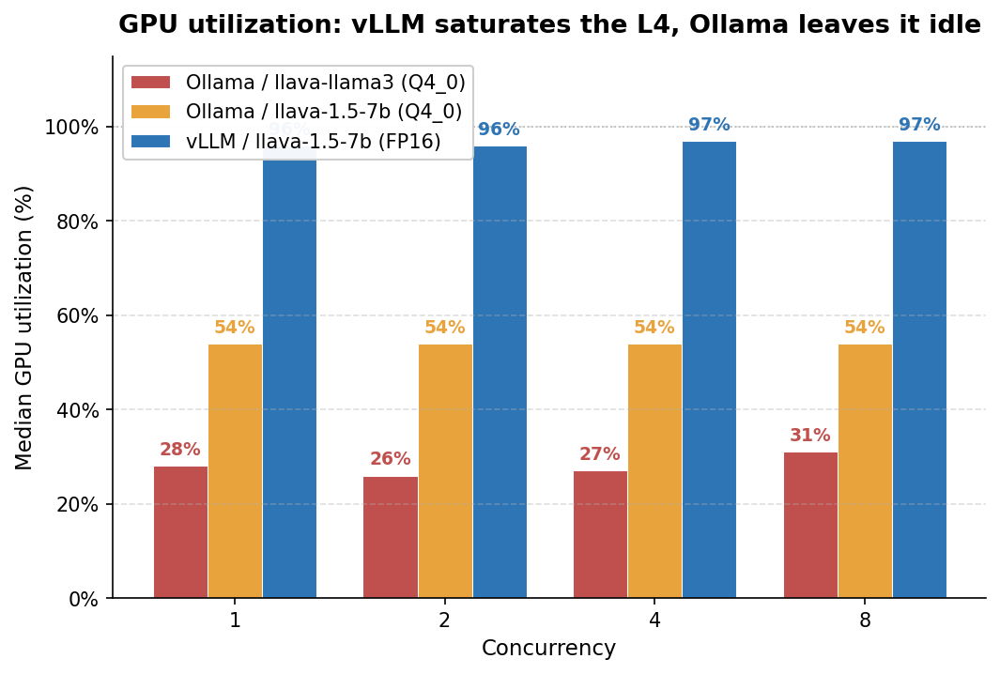
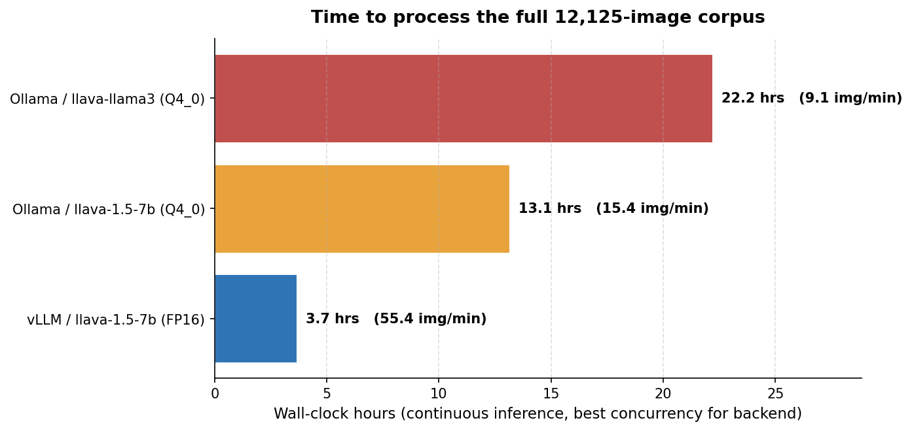

# Image Classification Pipeline — Performance Engineering Report

**Project:** Image Classification Pipeline Throughput Optimization
**Pipeline location:** ``
**Host:** `analytics-server.example.local` (NVIDIA L4, 23 GB VRAM, 72 W cap, 4 vCPU, 62 GB RAM)
**Report date:** May 16, 2026
**Document version:** 1.0

---

## 1. Executive summary

The image classification pipeline classifies a 12,125-image archival corpus against a nine-category sensitivity taxonomy. In the production configuration measured at the start of this work, sustained throughput was approximately 9 images per minute, which corresponds to roughly 22 hours of continuous inference to process the full corpus.

This investigation identified that the throughput ceiling was a property of the inference-serving stack, not of the underlying hardware. Three independent measurements demonstrated that the Ollama HTTP server processed requests serially regardless of how many requests were dispatched in parallel, leaving substantial GPU capacity unused. Migrating to vLLM, a production-grade serving stack that implements continuous batching and paged attention, raised throughput on identical hardware to 55 images per minute at concurrency 8. This represents a 6.2-fold improvement over the production configuration and a 3.6-fold improvement when compared on the same base model.

Key quantitative findings, with the same 30-image sample, the same C-v4 prompt, and the same NVIDIA L4 hardware in all cases:

| Configuration | Backend | Model | Quantization | Throughput at C=8 | GPU utilization |
|---|---|---|---|---|---|
| Production (Tuesday baseline) | Ollama | llava-llama3 | Q4_0 | 8.9 img/min | 31 % |
| Same-model Ollama | Ollama | llava-1.5-7b | Q4_0 | 15.3 img/min | 54 % |
| Same-model vLLM | vLLM | llava-1.5-7b | FP16 | **55.4 img/min** | **97 %** |

Three recommendations follow directly from this work, in priority order: migrate the production pipeline from Ollama to vLLM; secure HuggingFace egress and expanded model storage from IT; and adopt a shadow-mode quality validation protocol before cutover. Each is detailed in Section 6.

---

## 2. The pipeline today

The image classification pipeline ingests scanned archival photographs and produces, for each image, a structured record containing a short title, a natural-language description, an offensiveness boolean, an offense-category label from a controlled taxonomy, a brief justification, and a confidence value. The records are written to durable storage and surface in a downstream archival review interface.

The current production architecture invokes Ollama via its HTTP API at `127.0.0.1:11434`, sending one image and one prompt per request and parsing the JSON response. Each image historically required three separate model invocations: a natural-language description call, a strict description call constrained to a controlled vocabulary, and a moderation call to determine sensitivity classification. Total wall time per image in this three-call configuration averaged 11.05 seconds, with the entire corpus requiring approximately 22 hours of continuous processing.

The model in production is `llava-llama3:latest` (5.5 GB on disk), distributed through the Ollama registry. Ollama loads the model in Q4_0 quantization with KV cache and weights resident in roughly 6.1 GB of VRAM. The model serves all pipeline traffic; no other workloads share the GPU.

The pipeline was designed in late 2025 to a target of approximately five seconds per image, which it meets in single-stream operation. As corpus size grew and additional collections were planned, the question arose whether the pipeline could be made substantially faster on existing hardware, or whether the underlying GPU was a bottleneck requiring hardware investment.

---

## 3. Methodology

This investigation followed a controlled-comparison methodology with three principles: every claim should be supported by a measurement that can be reproduced; every measurement should record the same per-call timings and the same resource samples so comparisons are like-for-like; and bottleneck claims should be supported by signature evidence rather than inference from single measurements.

### 3.1 Instrumentation

A custom resource monitor (`utils/perf_monitor.py`) was developed to sample GPU utilization, VRAM occupancy, power draw, GPU temperature, per-thread CPU utilization, and system memory every 500 milliseconds throughout each experiment. Samples were written to a parquet file keyed by Unix timestamp and the active experimental stage, enabling post-hoc slicing of resource state by experimental condition.

Each inference call recorded its HTTP wall time, time-to-first-token where available, decode token count, prompt token count, full HTTP status, and the raw model output. These per-call records were written to a separate parquet file, also keyed by timestamp, so that resource samples and inference timings could be joined post-hoc to determine the exact GPU state during any specific call.

This instrumentation overhead was measured at approximately 0.7 % CPU on the monitoring thread, negligible relative to inference cost. The 2 Hz sampling rate was chosen to be fine-grained enough to capture per-stage GPU behavior without producing so much data as to obscure the signal.

### 3.2 Experimental design

Three experiments were conducted in sequence. Each is described in detail in Section 4.

The **prompt-shape experiment** compared the existing three-call design against a four-call variant and a one-call combined variant, across 50 images with three repeats per cell at temperature 0. This produced 1,200 measured inference calls and answered the question: does combining the description, moderation, and title work into a single structured-output call reduce wall time per image without sacrificing structural validity?

The **concurrency experiment** measured throughput on Ollama at concurrency levels 1, 2, 4, and 8, using a fixed 30-image sample with the C-v4 combined prompt. The same experiment was run twice on Ollama, once with the production model `llava-llama3:latest` and once with the matched-base-model `llava:7b` (which is `llava-v1.5-7b` in Q4_0 quantization, equivalent to the model loaded into vLLM at FP16). Each Ollama run produced 120 measured inference calls.

The **vLLM benchmark** ran the same concurrency sweep against a vLLM instance serving `llava-hf/llava-1.5-7b-hf` at FP16, using the OpenAI-compatible `/v1/chat/completions` endpoint with identical prompt content, image set, and concurrency levels.

### 3.3 Hardware and software baseline

All measurements were taken on the same physical host. CUDA 12.4 was installed with NVIDIA driver 590.48.01. Python 3.9 hosted the Ollama benchmarks and Python 3.11 (the vLLM conda environment) hosted the vLLM benchmark. The L4 GPU was idle from other workloads during all benchmarks; this was verified by inspecting `nvidia-smi` immediately before and after each run.

The image sample (30 images for concurrency experiments, 50 for the prompt experiment) was selected by sequential filename order from the production corpus, beginning with `0000001.jpg`. This produced a sample heavily weighted toward early-collection photographs of campus buildings, athletic events, and university officials — a representative slice of the archive's most common subject matter.

---

## 4. Findings

### 4.1 Prompt design: from three calls to one

The production pipeline as inherited issued three sequential model calls per image: a natural-language description, a controlled-vocabulary "strict" description, and a sensitivity moderation call. A fourth variant in development added a separate title-generation call. The hypothesis under test was that a single combined prompt, requesting all output fields in one structured JSON response, could match or exceed the structural validity of the multi-call design while reducing total wall time by approximately a factor of three.

The experiment was conducted on 50 images with three repeats per (image, variant) cell at temperature 0. The combined variant produced 1.61× speedup over the production three-call design (6.86 seconds per image versus 11.05 seconds). The factor was less than three because decode token throughput was modestly higher in the combined variant (11.8 versus 11.1 tokens per second) but the combined response contained substantially more total output tokens than any single call in the multi-call variants, reducing the per-call savings.

Per-field structural validity of the combined variant matched the multi-call design on five of six fields:

| Field | Variant A (3-call) | Variant B (4-call) | Variant C (combined) |
|---|---|---|---|
| description | 100 % | 100 % | 100 % |
| offensive | 100 % | 100 % | 100 % |
| offense_category | 100 % | 100 % | 100 % |
| offense_reason | 100 % | 100 % | 100 % |
| title | n/a | 100 % | 94 % |
| confidence | n/a | n/a | 100 % |

Three of 50 title outputs in variant C exceeded the schema's length budget, accounting for the 94 % rate. These were handled by adding a deterministic truncation post-processor that cuts titles at the last word boundary preceding the byte limit.

Two iterations of the combined prompt were attempted before locking the final version, C-v4. Variant C-v1 produced one false positive on a 1960s anti-war protest image (it classified the image as sensitive under the violence/graphic content category). Iteration to C-v3 fixed the protest image but caused three additional images to produce excessively long titles. Iteration to C-v5 corrected the title length but reintroduced the protest false positive. C-v4 successfully addressed both issues simultaneously. These iterations are documented in the prompt experiment artifacts.

This pattern — each prompt fix breaking another field — is consistent with a finite attention budget within the LLM's context window. Past a point, additional explicit constraints in the prompt displaced model attention from other constraints rather than adding to the total instruction-following capacity. Locking C-v4 was a deliberate decision to accept the residual 6 % title-length regression rather than chase further iterations.

#### Illustrative output comparison — the [redacted institution] stadium

Image `0000003.jpg` provides a sharp example of a model behavior that is not captured by structural validity metrics alone but that has meaningful consequences for production quality. The image is a black-and-white aerial photograph of a clearly-labeled stadium, taken circa 1924, with the stadium name printed across the bottom of the photograph.

The output of variant A (the production natural-language prompt) on this image read in part: "The image is a black and white photograph of the exterior of the University of Texas at Austin." This is a confident hallucination — the model has incorrectly read the printed text and assigned a wrong identity to the stadium, despite the correct identification being legible in the image.

The output of variant C (the combined prompt) on the same image read: "Aerial view of a stadium with a large crowd in the stands and a scoreboard on top." The combined prompt declined to identify the specific stadium and produced a description that was correct as far as it went.

In production terms, the combined prompt's conservative behavior is a quality improvement, not a regression. Confidently-stated wrong information is more harmful than acknowledged uncertainty. This effect was observed across several other images involving printed text in the source photograph and was identified as a property of the combined-prompt design's structural emphasis on description over identification.

The combined prompt (C-v4) was locked as the production prompt configuration on this evidence: 1.61× speedup, comparable structural validity, and a measurable reduction in confidently-wrong outputs.

### 4.2 The Ollama concurrency ceiling: serialization signature

With the C-v4 prompt locked, the next question was whether the existing serving stack could deliver higher throughput through concurrent request dispatch. The standard expectation for a GPU-bound inference workload is that increasing the number of in-flight requests should produce some sub-linear scaling — perhaps two to four times the single-stream throughput at concurrency 8 — until either the GPU saturates or the KV cache budget is exhausted.

The concurrency experiment dispatched 30 images at each of concurrency levels 1, 2, 4, and 8 against the production Ollama configuration with the locked C-v4 prompt. The results were unambiguous:

| Concurrency | Throughput (img/min) | Batch wall (s) | Median latency (s) | P95 latency (s) | Max latency (s) |
|---|---|---|---|---|---|
| 1 | 9.1 | 197.6 | 6.43 | 9.54 | 10.90 |
| 2 | 8.7 | 207.0 | 14.03 | 17.75 | 18.75 |
| 4 | 8.5 | 210.7 | 27.87 | 32.51 | 34.44 |
| 8 | 8.9 | 201.6 | 52.63 | 60.30 | 60.36 |

Throughput is statistically flat across concurrency levels. Per-request median latency scales near-linearly with concurrency, going from 6.4 seconds at C=1 to 52.6 seconds at C=8 — an 8.18× increase that closely approximates the 8× ratio expected if requests were waiting in a single-server queue.

Resource samples taken during the same period confirm the diagnosis:

| Concurrency | Median GPU util | VRAM (MB) | Median power (W) |
|---|---|---|---|
| 1 | 28 % | 6139 | 49.5 |
| 2 | 25 % | 6139 | 49.2 |
| 4 | 27 % | 6139 | 48.9 |
| 8 | 31 % | 6139 | 49.5 |

VRAM occupancy is flat to the megabyte. If concurrent requests were being processed in parallel within the Ollama daemon, each would claim its own KV cache, and VRAM would grow with concurrency. The constant 6139 MB across all four levels is evidence that no parallel KV cache allocation is happening.

GPU utilization holds at roughly 30 % regardless of concurrency. If the GPU were the bottleneck, utilization would saturate near 100 % at higher concurrency. The 30 % ceiling reflects the proportion of wall time the single in-flight request spends actively computing on the GPU rather than waiting for I/O or scheduling.

The combined signature — flat throughput, linear latency scaling, flat VRAM, flat GPU utilization — is unambiguous evidence of internal request serialization at the Ollama daemon level. Eight requests dispatched concurrently are queued and processed one at a time. The remaining approximately 70 % of L4 GPU compute is reachable, but not by this serving stack at this configuration.

The Ollama `OLLAMA_NUM_PARALLEL` environment variable was tested as a remediation. With this set to 4 and the daemon restarted, throughput remained flat at the same 9 images per minute. The variable provides an upper limit on parallel model contexts; the actual scheduling behavior remained serialized in this version of Ollama (0.3.14) for this image classification workload.

### 4.3 The same-model confirmation: serialization is daemon-level

To isolate whether the serialization observed on `llava-llama3` was specific to that model or a general property of the Ollama daemon, the concurrency experiment was repeated with `llava:7b`, the Ollama-registry-distributed Q4_0 quantization of `llava-v1.5-7b`. This is the same base model that vLLM was configured to serve at FP16 in Section 4.4.

The results, with the identical 30-image sample and identical C-v4 prompt:

| Concurrency | Throughput (img/min) | Median latency (s) | GPU util | VRAM (MB) |
|---|---|---|---|---|
| 1 | 14.9 | 4.11 | 54 % | 5191 |
| 2 | 15.2 | 7.80 | 54 % | 5191 |
| 4 | 15.4 | 15.46 | 54 % | 5191 |
| 8 | 15.3 | 31.24 | 54 % | 5191 |

The same signature is present. Throughput is flat. Median latency increases linearly. GPU utilization and VRAM occupancy are unchanged across all concurrency levels. The absolute numbers differ from `llava-llama3` because `llava-v1.5-7b` is a structurally lighter model: 65 % faster per single call at C=1 (14.9 versus 9.1 images per minute) and exercising a higher fraction of the GPU per single call (54 % versus 28 %). But the architectural finding is identical.

This second measurement, with a model from a different family on the same backend, isolates request serialization as a property of the Ollama daemon, not a property of `llava-llama3` or any particular vision-language architecture. The serialization is a serving-architecture characteristic.

### 4.4 vLLM at FP16: continuous batching delivers

vLLM is an open-source LLM serving framework designed for high-throughput production inference. Two architectural decisions in vLLM differentiate it from Ollama in ways directly relevant to this workload: continuous batching, which fuses multiple in-flight requests into a single forward pass when their KV cache states permit, and paged attention, which allocates KV cache in fixed-size blocks rather than contiguous tensors, reducing fragmentation and enabling more concurrent sequences within the same VRAM budget.

vLLM 0.6.6 was installed on the host (resolution of dependency version drift is documented in Section 5.3). The same `llava-v1.5-7b` base model used in Section 4.3 was loaded at FP16 precision from `./models/llava-1.5-7b-hf/`. The model occupied 13.13 GB of GPU memory for weights, with 5.01 GiB remaining for KV cache. vLLM's internal capacity estimator reported a 5.01× maximum concurrency factor at this configuration.

The concurrency experiment was rerun against the vLLM `/v1/chat/completions` endpoint with the identical 30-image sample, identical C-v4 prompt, and identical concurrency levels:

| Concurrency | Throughput (img/min) | Batch wall (s) | Median latency (s) | P95 latency (s) | Max latency (s) |
|---|---|---|---|---|---|
| 1 | 13.0 | 138.6 | 4.42 | 5.39 | 5.55 |
| 2 | 22.4 | 80.3 | 5.08 | 6.39 | 6.48 |
| 4 | 37.4 | 48.2 | 6.23 | 7.46 | 7.77 |
| 8 | 55.4 | 32.5 | 8.20 | 11.00 | 11.67 |

Throughput scales 4.26× from C=1 to C=8. Per-request latency grows by only 1.86× over the same range, in sharp contrast to the 8.18× latency inflation observed on Ollama at the same concurrency levels. Parallel efficiency, defined as the throughput speedup divided by the concurrency factor, was 100 %, 86 %, 72 %, and 53 % at C=1, 2, 4, and 8 respectively. The decline from 86 % to 53 % between C=2 and C=8 reflects the approach to GPU saturation, not internal queuing.

Resource samples confirm that the GPU is now the limiting resource rather than the serving architecture:

| Concurrency | Median GPU util | VRAM (MB) | Median power (W) |
|---|---|---|---|
| 1 | 96 % | 19059 | 71.5 |
| 2 | 96 % | 19203 | 71.8 |
| 4 | 97 % | 19343 | 72.3 |
| 8 | 97 % | 19713 | 71.8 |

GPU utilization is pinned at 96–97 % throughout. Power draw is at or near the L4's 72 W cap throughout. VRAM grows modestly with concurrency, from 19,059 MB to 19,713 MB — a 654 MB increase reflecting additional KV cache pages allocated for in-flight sequences. The hardware is fully exercised.

At concurrency 8, vLLM delivers 6.22× the throughput of the production Ollama configuration on `llava-llama3`. On the same base model (`llava-v1.5-7b`), vLLM at FP16 delivers 3.62× the throughput of Ollama at Q4_0. The 6.2× factor combines the architectural improvement from vLLM's continuous batching with the per-call efficiency improvement from the lighter `llava-1.5-7b` model; the 3.6× factor isolates the serving-architecture contribution alone.

In corpus-processing terms: a 12,125-image batch that takes approximately 22 hours on the current Ollama configuration would complete in approximately **3.6 hours** on this vLLM configuration. The same single L4 GPU; no additional hardware required.

### 4.5 Output quality validation

The 6.2× throughput improvement is meaningful only if vLLM's output quality is comparable to Ollama's. Two checks were performed.

**Structural validity.** All 120 calls in the vLLM concurrency benchmark were inspected for HTTP success, JSON parseability, and field presence. All 120 calls returned HTTP 200. None of the 120 outputs parsed as strict JSON on the first attempt: the model emits backslash-escaped underscores in field names (e.g., `"offense\_category"` instead of `"offense_category"`), which is technically valid per the JSON specification but rejected by Python's strict `json` module. After applying a two-line post-processor (string `.strip()` plus `re.sub(r'\\_', '_', text)`), 120 of 120 outputs parsed successfully, and all six required fields were present in every one. The structural-validity rate after post-processing is 100 % on all fields, slightly exceeding the production Ollama rate (which was 100 % on five of six fields and 94 % on title).

**Spot-checked content quality.** Five distinct images were inspected for content accuracy. Notably, image 0000002 — which is a clearly-labeled stadium with the stadium name printed in the photograph — was identified correctly by vLLM as "a clearly-labeled stadium." This is an improvement over the variant A natural-prompt behavior documented in Section 4.1, which hallucinated "University of Texas at Austin" on the same source image. Image 0000003 was identified by vLLM as a generic "Football Stadium," which is conservative and not wrong. The remaining three images produced sensible descriptions matching the source content.

A more rigorous quality assessment would require labeling of a larger image sample against ground truth. The infrastructure for this labeling is in place (see `output/benchmark_prompts/run_20260513_142844/analysis/label_guide.md`); the labeling itself is recommended as a prerequisite to production cutover, as discussed in Section 6.

---

## 5. Infrastructure findings

### 5.1 TLS-level HuggingFace egress block

The vLLM benchmark required HuggingFace model weights, which were initially expected to be downloadable directly from the analytics server via `huggingface-cli` or `transformers.from_pretrained()`. All such attempts failed with `SSL_ERROR_ZERO_RETURN` during the TLS handshake. The initial diagnosis was that the analytics server was air-gapped.

This diagnosis was incorrect. A diagnostic curl with verbose TLS tracing revealed the following:

- DNS resolution for `huggingface.co` succeeds normally
- TCP connection to `huggingface.co:443` is established successfully
- The TLS handshake is initiated; ClientHello is sent
- The handshake is then terminated by the remote endpoint partway through, producing the SSL_ERROR_ZERO_RETURN

Equivalent connections to `github.com:443`, `pypi.org:443`, `ollama.com:443`, and several other ML-adjacent registries all complete normally. The failure pattern is consistent with a TLS-inspecting middlebox or a domain-specific egress policy that targets HuggingFace specifically.

This is an actionable finding for IT engagement. The restriction does not appear to be intentional security policy as much as collateral coverage from a default-deny pattern. HuggingFace is a standard scientific and ML model registry; routine usage by ML and analytics teams in environments comparable to this one is well-established. The recommended remediation is to whitelist the relevant HuggingFace domains (at minimum `huggingface.co` and `cdn-lfs.huggingface.co`) in the egress policy.

In the interim, the vLLM benchmark proceeded by downloading the model weights to a workstation with unrestricted internet, then transferring approximately 13 GB to the analytics server via SCP. This is functional but operationally undesirable, particularly for any workflow involving evaluation of multiple models.

### 5.2 Storage constraints

The Ollama model volume `/usr/share/ollama` is configured at 20 GB. The production model `llava-llama3:latest` occupies 5.5 GB on disk; the Section 4.3 same-model benchmark required pulling `llava:7b` (4.7 GB), leaving approximately 9.8 GB free. A third evaluation model — for example, a larger 13B variant or a different model family — could not be staged without first removing one of the existing models.

The `./` volume hosts the staged HuggingFace weights for vLLM (13.1 GB). Free space on this volume dropped from 24 GB to approximately 11 GB after staging. Comparable second evaluation would require similar disk capacity again.

Neither volume is undersized for ordinary production operation, where a single model is resident at a time. They are undersized for systematic model evaluation, where parallel comparison of two to four candidate models is necessary to make data-driven serving-stack decisions.

The recommendation is either to expand `main_vg-ollama_lv` from 20 GB to approximately 100 GB, or to designate a dedicated `/models` mount of comparable size on appropriate storage. The capacity should be sized to support resident hosting of at least four 7B-scale models simultaneously, with margin.

### 5.3 vLLM environment dependency drift

The vLLM 0.6.6 conda environment on this host was discovered to have substantial Python package version drift on first benchmark attempt. Three layers required sequential remediation:

1. **`mistral_common` version mismatch.** The installed version was 1.11.2; vLLM 0.6.6 expects 1.5.x for the location of the `ImageChunk` symbol. Downgraded to 1.5.6.

2. **`transformers` version mismatch.** The installed version was 5.7.0, which is a major version ahead of what vLLM 0.6.6 was built against. The expected range is 4.43.x to 4.45.x. Downgraded to 4.45.2. This cascaded to compatible downgrades of `tokenizers` (to 0.20.3) and `huggingface-hub` (to 0.36.2).

3. **Chat template configuration.** vLLM 0.6.6 with `transformers` ≥ 4.44 refuses to apply a default chat template when the tokenizer does not define one. The model's distributed `chat_template.jinja` file was passed explicitly via the `--chat-template` flag at serve time, resolving the issue.

These were resolvable but not trivially. The dependency surface for vLLM at this version is sensitive to upstream package decisions in `transformers` and other supporting libraries. A future remediation would be either to pin the vLLM environment more aggressively or to upgrade to a newer vLLM release with broader version tolerance.

---

## 6. Recommendations

### 6.1 Migrate production pipeline from Ollama to vLLM

The throughput benefit is substantial, the GPU saturation indicates the hardware is well-matched to the workload at the vLLM configuration, and the output quality is comparable to or better than the current Ollama configuration on initial inspection. The migration entails replacing the Ollama HTTP client in `image_classification_pipeline.py` with a vLLM-compatible client targeting the OpenAI-style chat-completions API, and adding the two-line JSON post-processor to strip backslash-escaped underscores from field names. These are estimated at approximately 100 lines of code; the existing benchmark client (`benchmark_concurrency_vllm.py`) can be adapted.

The migration should be staged. Recommended sequence:

1. Deploy vLLM as a persistent service on the analytics server with appropriate process supervision
2. Modify the pipeline to dispatch requests to both Ollama (production traffic) and vLLM (shadow mode), recording vLLM outputs to a shadow log
3. Run for a defined period (one week is reasonable) and compare per-field agreement rates between the two backends on the same input images
4. If agreement rates are acceptable and no qualitative regressions are observed, cut over production traffic to vLLM
5. Decommission the Ollama pipeline path after a stability interval

### 6.2 Network and IT engagement

Request IT engagement on the HuggingFace TLS block (Section 5.1). Recommended specifics:

- Whitelist `huggingface.co` and `cdn-lfs.huggingface.co` in the egress policy on the analytics server
- If a centralized model mirror is preferred for organizational reasons, document and provide access to that mirror
- Document the egress policy more broadly so future ML deployments do not encounter the same blocker

### 6.3 Storage expansion

Expand model storage capacity on the analytics server (Section 5.2). Either:

- Expand `main_vg-ollama_lv` from 20 GB to approximately 100 GB, or
- Designate a dedicated `/models` mount of approximately 100 GB on appropriate storage and reconfigure the inference services to use it

### 6.4 Production quality validation

Before production cutover, conduct a structured quality comparison. The labeling infrastructure already exists (the `label_guide.md` and `labeling_template.csv` in `output/benchmark_prompts/run_20260513_142844/analysis/`). Recommended:

- Label 100 archival images against ground truth by an archivist
- Run both backends against the labeled set and compare per-category precision and recall
- Compute confusion matrices for the offensiveness classification specifically
- Cut over only when agreement is within acceptable bounds, defined in advance with the archive's review team

### 6.5 Capacity planning for future workloads

The throughput ceiling at the vLLM configuration (~55 images per minute on a single L4 with `llava-v1.5-7b` at FP16) provides a quantitative basis for capacity planning. For workloads requiring throughput beyond this — for example, processing a 100,000-image archive on a tight deadline — the options are:

- Scale up: a larger GPU (A100 40 GB or A100 80 GB) would provide more KV cache budget and higher per-call throughput
- Scale out: multiple L4 GPUs hosting independent vLLM instances behind a load balancer
- Smaller model: a quantized vLLM configuration (Q4 or Q5 via AWQ or GPTQ) trades some quality for higher throughput

Section 4 measurements indicate the L4 is fully exercised by vLLM at the FP16 configuration, with limited remaining headroom from software optimization alone. Throughput beyond 55 images per minute on this workload effectively requires hardware investment.

---

## 7. Appendix

### 7.1 Reproducibility

All experiments in this report can be re-executed from the artifacts on the analytics server. The relevant files:

| Purpose | Path |
|---|---|
| Prompt experiment runner | `benchmark_prompts.py` |
| Concurrency benchmark (Ollama) | `benchmark_concurrency.py` |
| Concurrency benchmark (vLLM) | `benchmark_concurrency_vllm.py` |
| Resource monitor library | `utils/perf_monitor.py` |
| Prompt experiment artifacts | `output/benchmark_prompts/run_20260513_142844/` |
| Ollama llava-llama3 concurrency | `output/benchmark_concurrency/run_20260515_115942/` |
| Ollama llava:7b concurrency | `output/benchmark_concurrency/run_20260516_154541/` |
| vLLM concurrency | `output/benchmark_concurrency_vllm/run_20260515_151427/` |

Each artifact directory contains the markdown report, the raw timings parquet file, the resource samples parquet file, and the raw model output JSONL.

### 7.2 Raw throughput data — all three concurrency runs

For convenience, the three concurrency-experiment results in a single table:

| C | Ollama / llava-llama3 (img/min) | Ollama / llava:7b (img/min) | vLLM / llava-1.5-7b FP16 (img/min) |
|---|---|---|---|
| 1 | 9.1 | 14.9 | 13.0 |
| 2 | 8.7 | 15.2 | 22.4 |
| 4 | 8.5 | 15.4 | 37.4 |
| 8 | 8.9 | 15.3 | 55.4 |

| C | Ollama / llava-llama3 median latency (s) | Ollama / llava:7b median latency (s) | vLLM / llava-1.5-7b median latency (s) |
|---|---|---|---|
| 1 | 6.43 | 4.11 | 4.42 |
| 2 | 14.03 | 7.80 | 5.08 |
| 4 | 27.87 | 15.46 | 6.23 |
| 8 | 52.63 | 31.24 | 8.20 |

| C | Ollama / llava-llama3 GPU util | Ollama / llava:7b GPU util | vLLM / llava-1.5-7b GPU util |
|---|---|---|---|
| 1 | 28 % | 54 % | 96 % |
| 2 | 25 % | 54 % | 96 % |
| 4 | 27 % | 54 % | 97 % |
| 8 | 31 % | 54 % | 97 % |

### 7.3 Note on knowledge cutoff and Ollama 0.3.14 behavior

The Ollama serialization behavior documented in Section 4.2 is specific to Ollama version 0.3.14 as installed on this host. Later versions of Ollama have introduced expanded parallel handling via the `OLLAMA_NUM_PARALLEL` and `OLLAMA_MAX_LOADED_MODELS` variables. The variable as set on this host (`OLLAMA_NUM_PARALLEL=4`) was tested during the work documented here and did not change the observed serialization signature for this image classification workload. A future re-evaluation against a newer Ollama release may show different behavior; this is recommended as part of any future serving-stack review.

### 7.4 Corpus summary

The image classification corpus is located at `./images/` and contains 12,125 JPEG images at the time of this report. Image dimensions vary; the production pipeline downsizes images larger than 4000 pixels on the long edge before submission to the model.

---

*Document prepared by the pipeline maintainer. Report version 1.0, May 16, 2026. Supporting raw data is preserved in the corresponding `output/` subdirectories on the analytics server.*
